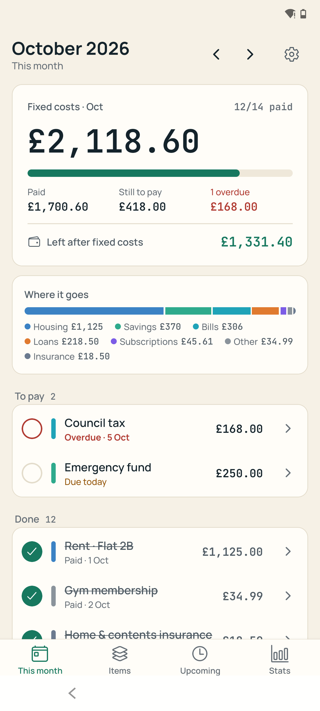
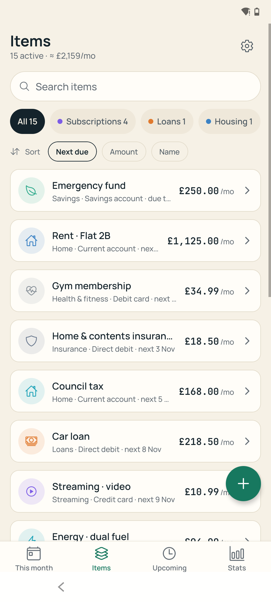
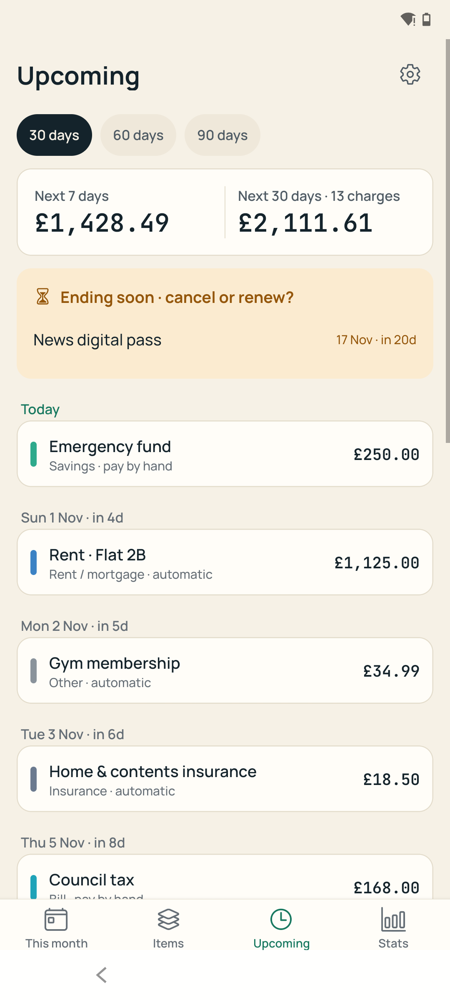
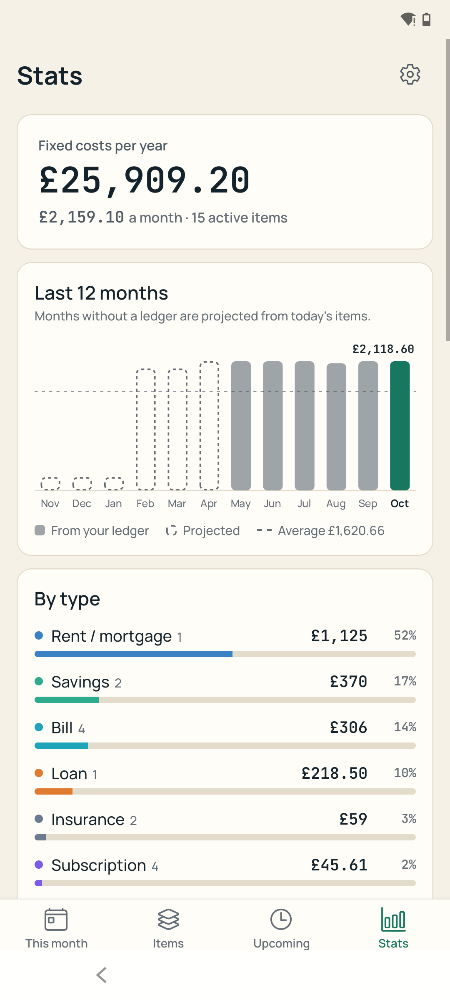
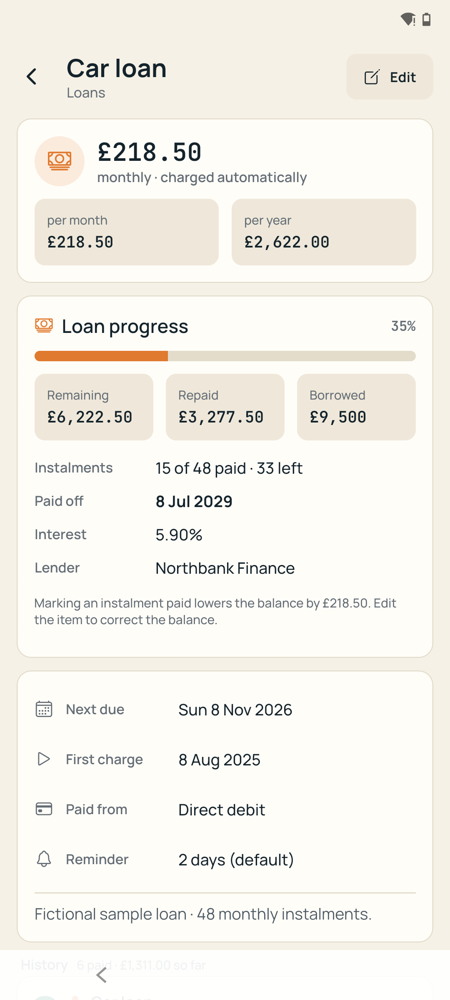
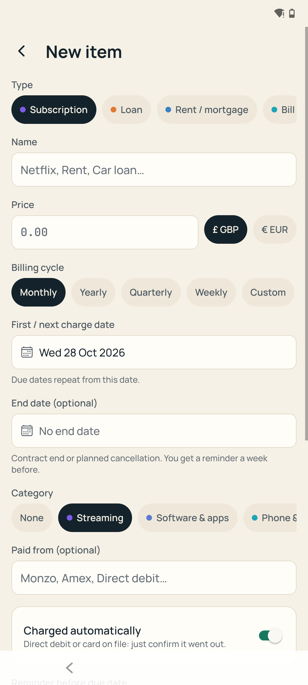
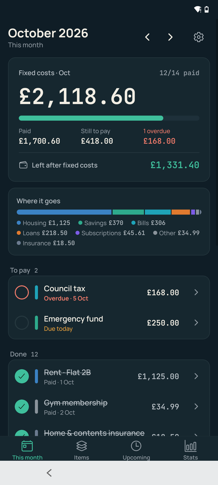
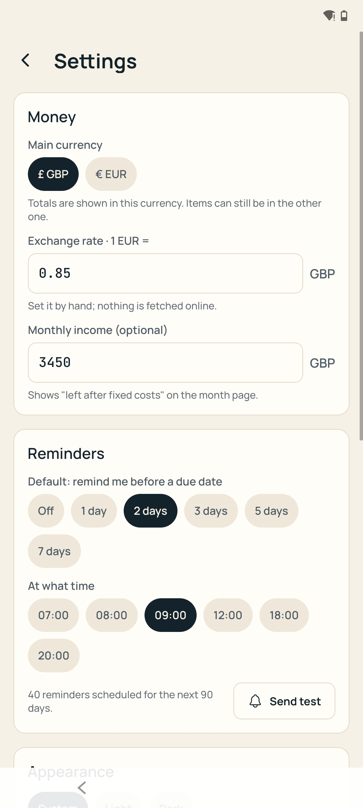

# Monthly Ledger

**An offline Android app that answers one question: what do my fixed costs add up to this month, and what is still left to pay?**

Subscriptions, rent, loans, bills, insurance and savings goals in one monthly checklist. Everything stays on the phone: no account, no bank connection, no cloud. Backups are plain JSON you export yourself.

Built with Expo (React Native) and TypeScript. Personal project, used on my own phone.

<!-- Screenshots: generated with scripts/portfolio-screenshots.sh using the built-in fictional sample data -->
| This month | Items | Upcoming | Stats |
|---|---|---|---|
|  |  |  |  |

| Loan detail | New item | Dark mode | Settings |
|---|---|---|---|
|  |  |  |  |

> All amounts in the screenshots come from the app's **sample data** (Settings → Sample data). They are fictional.

## Features

- **This month** — total fixed costs for the month, how much is paid / still to pay / overdue, and what is left of your income. Tap a row to mark it paid, hold it to skip a month or undo. Browse past and future months.
- **Items** — every fixed cost with search, type filters, sorting and an archive. Weekly, monthly, quarterly, yearly or custom cycles, end dates, autopay flag, payment method, per-item reminders.
- **Loans and savings** — remaining balance, instalments paid and payoff date for loans; target, progress and suggested monthly amount for savings. Marking a payment paid updates them.
- **Upcoming** — every charge in the next 30/60/90 days grouped by day, plus items that are ending soon (cancel or renew?) or have ended (archive?).
- **Stats** — 12-month trend (recorded months vs projected), split by type and category, yearly cost of each item.
- **Reminders** — local notifications N days before a due date, rescheduled after every change.
- **Two currencies** — GBP and EUR with a manual exchange rate; totals in your main currency.
- **Your data** — JSON backup/restore through the share sheet, CSV export of the ledger.
- **Light and dark theme**, WCAG AA text contrast, 44dp touch targets, TalkBack labels.

## Architecture

```
app/            expo-router screens: 4 tabs + item detail, new/edit (modal), settings, categories
lib/domain/     pure TypeScript: dates, billing cycles, monthly ledger, loans, savings, upcoming, stats
lib/db/         SQLite repositories (all SQL lives here) + numbered migrations
lib/store/      Zustand stores: settings, items, ledger of the month on screen
lib/components/ small design system: Txt, Card, Button, Chip, Money, BarChart (react-native-svg)...
lib/features/   composed UI: payment row, item row, loan/savings progress, item form, sample data
lib/demo/       fictional sample household, loaded through the same store/repository calls as the UI
tests/          Jest tests for the domain layer
```

- **Local-first.** One SQLite database (`expo-sqlite`, WAL, foreign keys). Migrations tracked with `PRAGMA user_version`.
- **Domain layer without React Native.** Billing cycles (month-end clamping, weekly items with 4 or 5 charges a month), ledger generation, loan payoff and savings projections are pure functions covered by **33 Jest tests**.
- **Lazy ledger.** Opening a month generates its payment rows from the item definitions. Amounts are snapshotted, so editing an item never rewrites history; only unpaid rows of current and future months are re-synced.
- **Stores, not screens, talk to the database.** Every item change goes through one store action that also re-syncs the month on screen and reschedules reminders.
- **Money in minor units** (integer pence/cents) everywhere; formatting in one place.

| | |
|---|---|
| Expo SDK 57, React Native 0.86 (new architecture), React 19 | expo-router 57 (tabs, stack, modals, deep links `monthlyledger://`) |
| expo-sqlite, Zustand 5 | react-native-svg (custom bar chart) |
| expo-notifications (local only) | expo-file-system / sharing / document-picker (backup) |
| TypeScript 6 (strict), Jest 30 + jest-expo | Manrope + JetBrains Mono for numbers |

More: [`docs/architecture.md`](docs/architecture.md) (architecture and stack), [`docs/plan/00-functional-spec.md`](docs/plan/00-functional-spec.md) (functional spec), [`docs/ui-review.md`](docs/ui-review.md) (UI audit and changes), [`docs/BUILD.md`](docs/BUILD.md) (local Android build notes).

## Run it

```bash
npm install
npm test            # 33 domain tests
npm run typecheck   # tsc --noEmit
npx expo start      # dev server (Expo dev build / emulator)
```

Release APK (local build, Windows, arm64-v8a only):

```bash
npx expo prebuild --platform android --no-install
cd android && ./gradlew assembleRelease -PreactNativeArchitectures=arm64-v8a
```

Release signing reads a local keystore from `signing/` (git-ignored); without it the build falls back to the debug key. Build pitfalls I hit with Expo SDK 57 on Windows (peer versions, stale CMake caches, a 260-character path in ninja) are written up in [`docs/BUILD.md`](docs/BUILD.md).

## Download

A signed APK will be published on the [Releases](../../releases) page. Android 8.0+ (arm64).

## How it was built

Designed and developed by me with **AI-assisted development (Claude Code)**: I wrote the functional spec and the phase plan, made the product and architecture decisions, and reviewed and tested the code; the assistant wrote most of the implementation under that plan. The domain tests, the build troubleshooting notes and the UI review in `docs/` are part of that process.

## License

Released under the [MIT License](LICENSE).
